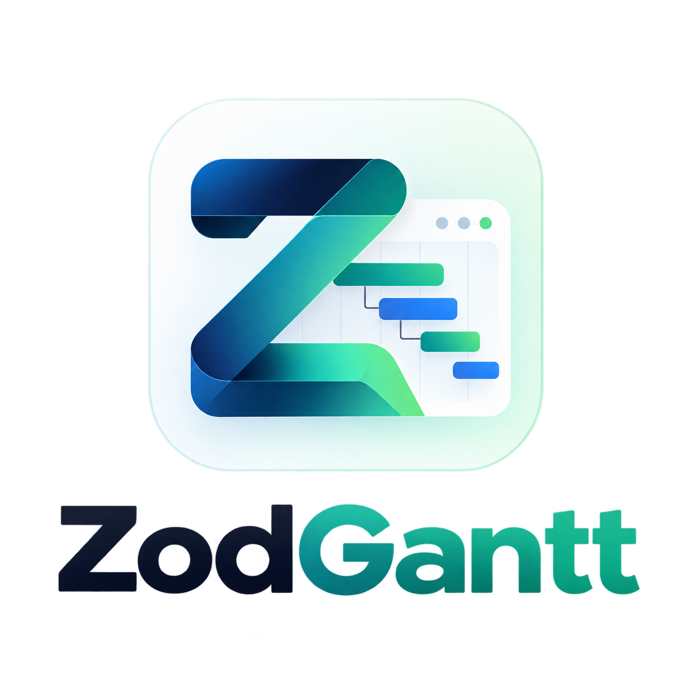
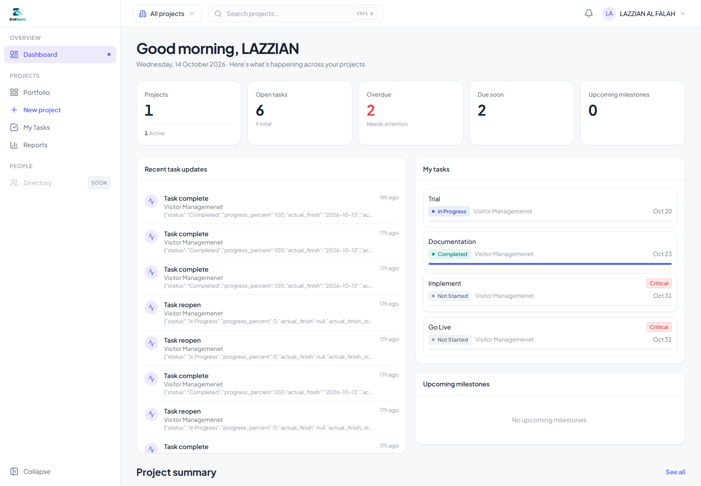
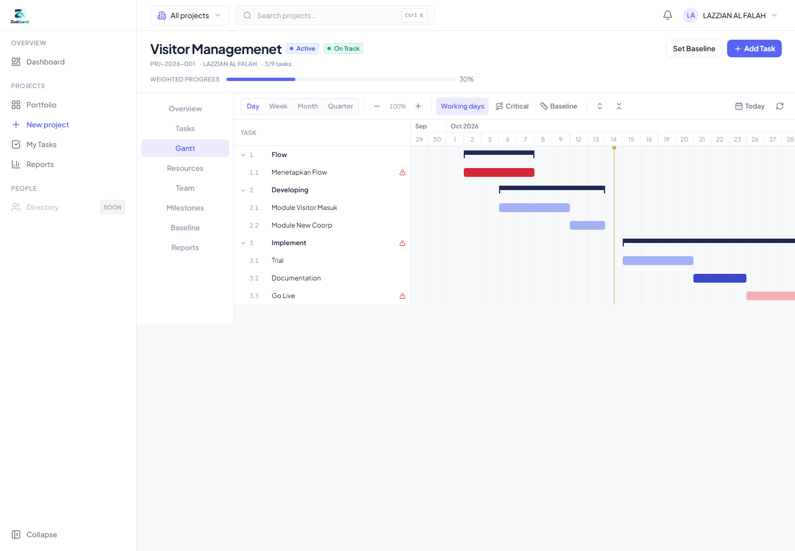
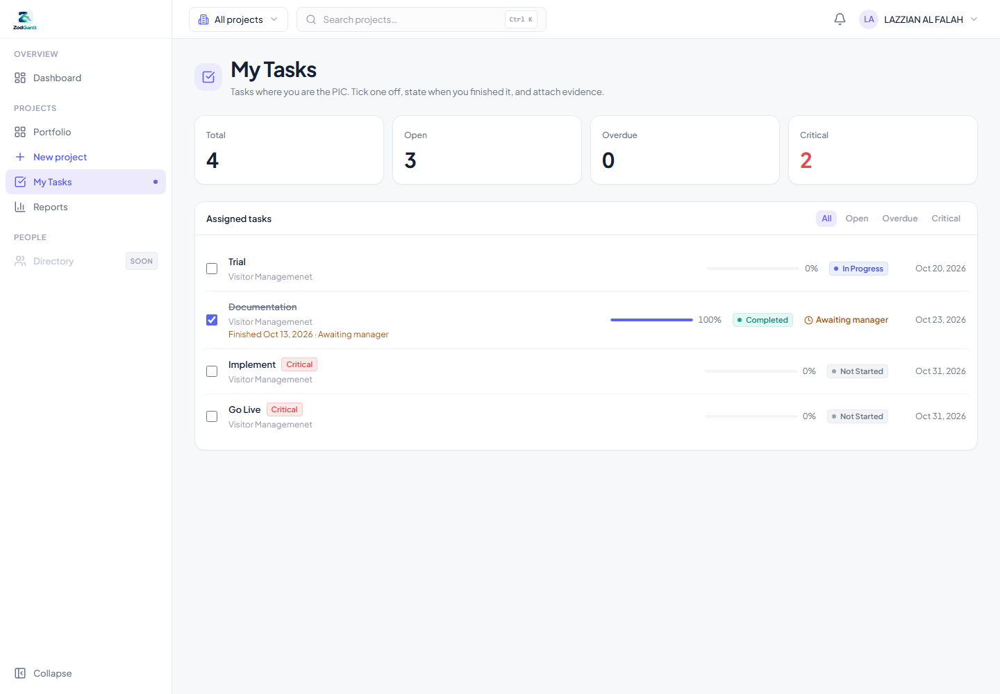
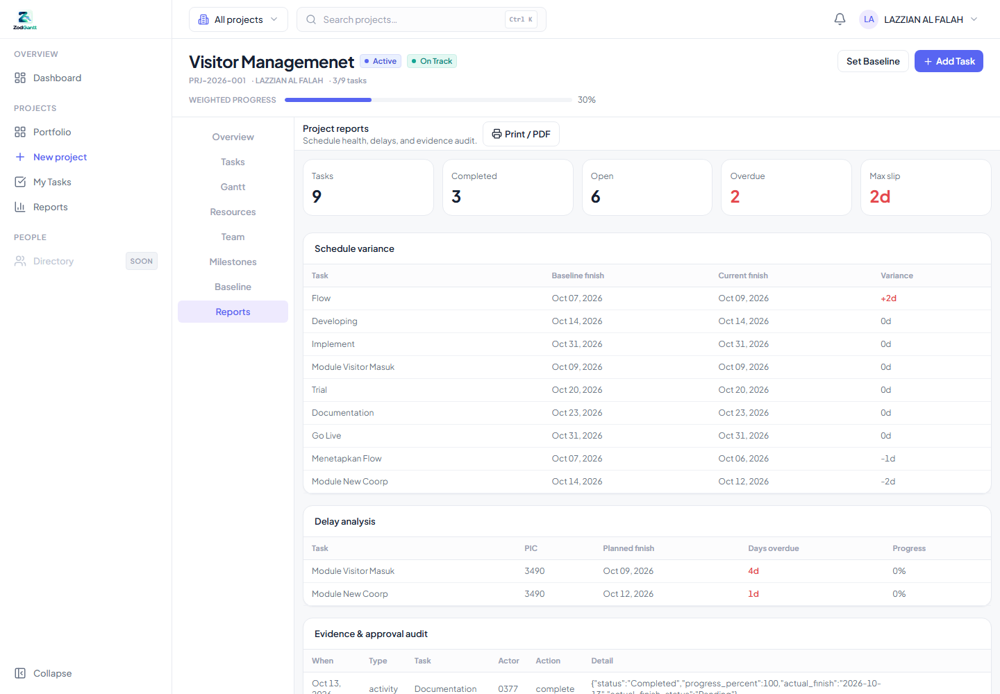

<div align="center">



# ZodGantt

**Server-authoritative project scheduling with a delivery accountability trail.**

Plan → schedule → execute → prove → approve → report.

[](https://react.dev)
[](https://www.typescriptlang.org)
[](https://vitejs.dev)
[](https://tailwindcss.com)
[](https://expressjs.com)
[](https://microsoft.com/sql-server)
[](https://vitest.dev)

</div>

---

## The problem

Most Gantt tools stop at the plan. They show you a bar chart, but they cannot answer the three questions that actually matter during delivery:

1. **Did this task actually finish, and when?**
2. **Can I prove it?**
3. **Who approved the date?**

Reporting progress in a spreadsheet next to the schedule creates drift, disputes, and no audit trail.

## What ZodGantt does

ZodGantt closes the loop between planning and proof. The scheduling engine stays authoritative on the server, and every completion carries an evidence trail with a manager approval step.

| Capability | Detail |
| --- | --- |
| **Server-authoritative CPM** | Forward/backward pass, total and free float, critical path, working calendars. The engine is pure and does no I/O. |
| **Interactive Gantt** | Custom rendering (no third-party gantt library): virtualized rows, SVG dependency layer, WBS hierarchy, drag/resize, zoom, critical-path and baseline overlays, today marker. |
| **PIC-owned tasks** | `My Tasks` is scoped to the signed-in person's `pic_nip`, not to resource assignment. |
| **Completion workflow** | A tick asks *when* it actually finished, then records an as-built date. |
| **Evidence capture** | Optional note and/or file (PDF, images, Office docs) up to 5 MB, stored with a content hash and served through an authenticated endpoint. |
| **Manager approval** | A submitted finish date is `Pending` until a manager approves or rejects it. Rejection rolls the task back to `In Progress` and forces a resubmission. |
| **Reports** | Schedule variance vs baseline, delay analysis, and an evidence/approval audit trail, with browser print/PDF. |
| **HRIS boundary** | The people directory is read-only and reached through a single `EmployeeProvider` adapter. The app schema holds no foreign key to HRIS. |

## Screenshots

<div align="center">
<table>
<tr>
<td width="50%"><br /><sub><b>Dashboard</b> — health, overdue work, milestones, live activity</sub></td>
<td width="50%"><br /><sub><b>Gantt</b> — WBS, critical path, baseline overlay</sub></td>
</tr>
<tr>
<td width="50%"><br /><sub><b>My Tasks</b> — PIC checklist and approval state</sub></td>
<td width="50%"><br /><sub><b>Reports</b> — variance, delays, audit trail</sub></td>
</tr>
</table>
</div>

## How the completion loop works

```text
   PIC ticks the task
            │
            ▼
   "Finished on ____"  +  optional note / file
            │
            ▼
   status = Completed, progress = 100
   actual_finish = <date>, status = Pending
            │
            ▼
   Manager opens Project → Tasks → Actual finish dates
            │
      ┌─────┴─────┐
      ▼           ▼
   Approve     Reject (reason required)
      │           │
      ▼           ▼
   Approved    status = In Progress, progress = 0,
   (locked)    actual_finish cleared → PIC resubmits
```

The submitted date lives in `actual_finish`, never in `finish_date`. The plan stays intact, so baseline variance remains meaningful and schedule slippage stays measurable.

## Architecture

```text
┌───────────────────────────────────────────────┐
│  frontend/   React 18 · Vite · Tailwind      │
│  Gantt = a pure view over server schedule     │
└───────────────────┬───────────────────────────┘
                    │  REST  ·  JWT  ·  { data | error }
┌───────────────────▼───────────────────────────┐
│  backend/    Express · TypeScript · Zod      │
│  routes → services → repositories → db       │
│  auth · projects · tasks · dependencies ·     │
│  scheduling · resources · evidence ·          │
│  reports · baselines · dashboard              │
└───────────────────┬───────────────────────────┘
                    │  mssql (parameterized)
┌───────────────────▼───────────────────────────┐
│  SQL Server  ·  schema `pm`  ·  17 forward-  │
│  only idempotent migrations                   │
│  HRIS read-only via EmployeeProvider adapter  │
└───────────────────────────────────────────────┘
```

Key decisions:

- **The Gantt never computes.** It renders the server's schedule; every edit is intent sent to the API, persisted, recalculated, and re-rendered from the response.
- **The scheduler is pure.** No database, no clock, no I/O — so it is directly testable.
- **Layered modules.** `routes → services → repositories → db`, with one documented responsibility per module.
- **Forward-only migrations.** Idempotent guards, no destructive `DROP`.

## Tech stack

**Frontend** — React 18, TypeScript, Vite 6, React Router 7, Tailwind CSS 3, Lucide icons, Vitest + Testing Library

**Backend** — Node.js, Express 4, TypeScript, Zod, `mssql`, `jsonwebtoken`, Multer, Vitest

**Database** — SQL Server, schema `pm`, 17 idempotent migrations

**Quality** — 218 passing tests, typecheck and production build wired into the root scripts

## Quick start

```bash
git clone https://github.com/LazzianT/Gantt.git
cd Gantt
npm run install:all
```

### Backend

```bash
cd backend
cp .env.example .env      # Windows: copy .env.example .env
npm install
npm run migrate
npm run dev
```

Set at minimum in `backend/.env`:

```env
DB_SERVER=
DB_DATABASE=
DB_USER=
DB_PASSWORD=
JWT_SECRET=
```

The API listens on `http://localhost:4000`. Health: `GET /health`, readiness: `GET /readyz`.

### Frontend

```bash
cd frontend
cp .env.example .env      # Windows: copy .env.example .env
npm install
npm run dev
```

```env
VITE_APP_NAME=ZodGantt
VITE_API_BASE_URL=
```

Leave `VITE_API_BASE_URL` empty to use the Vite dev proxy. The UI runs on `http://localhost:5174`.

### Authentication

Login is **NIP + date of birth**, validated against the read-only HRIS directory. There is no local password store. A dev-only demo fallback (`AUTH_DEMO_ENABLED`) exists for offline work and fails closed when `NODE_ENV=production`.

## Scripts

Run from the repository root:

| Script | Action |
| --- | --- |
| `npm run dev` | Start backend and frontend together |
| `npm run install:all` | Install dependencies in both workspaces |
| `npm run typecheck` | Typecheck backend and frontend |
| `npm test` | Run the full test suite |
| `npm run build` | Production build for both workspaces |

Backend-only: `npm run migrate`, `npm run db:tables`, `npm run db:seed-demo`.

## Project structure

```text
backend/
  src/
    config/        environment parsing
    db/            pool + migration runner
    middleware/    auth, project membership, error envelope
    modules/       one folder per bounded context
  sql/             forward-only migrations
frontend/
  src/
    app/           router, shell, topbar, command palette
    components/    shared UI primitives
    config/        runtime app configuration
    features/      feature folders (auth, tasks, gantt, workspace, ...)
    lib/           API client, auth, formatters
docs/              architecture, scheduling, database, design system
screenshots/        product showcase captures
```

## Documentation

| Document | Covers |
| --- | --- |
| [architecture.md](docs/architecture.md) | Layers, API map, architecture decisions |
| [scheduling-engine.md](docs/scheduling-engine.md) | CPM algorithm and calendar math |
| [gantt-engine.md](docs/gantt-engine.md) | Gantt view contract and interaction model |
| [database-design.md](docs/database-design.md) | `pm` schema and migrations |
| [employee-integration.md](docs/employee-integration.md) | HRIS boundary and adapter |
| [authentication.md](docs/authentication.md) | JWT auth, roles, hardening |
| [design-system.md](docs/design-system.md) | Tokens, components, responsive rules |
| [STATUS.md](docs/STATUS.md) | Milestones, verification, known tech debt |

## Roadmap

- Calendar endpoint and Gantt axis binding
- Transaction wrapper for multi-write flows
- Integration and end-to-end tests against a live SQL Server
- DTO normalization for the remaining raw endpoints
- Richer export options beyond browser print

See [STATUS.md](docs/STATUS.md) for the full ledger, including known issues.

## Contributing

Issues and pull requests are welcome. Please include what changed, why, and how you verified it — `npm run typecheck && npm test` should pass before opening a PR.

---

<div align="center">
Built with care. <sub>ZodGantt</sub>
</div>